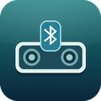

# DockBridge 4S



把一台已越狱的 iPhone 4s 用作 Bose SoundDock II 的蓝牙音频接收器。安卓手机通过系统蓝牙发送音乐，DockBridge 接收 A2DP／SBC 立体声音频，并交给 iOS 的媒体输出。iPhone 可长期插在 30 针底座上。

[下载 0.2.11 测试版](https://github.com/EricStuart/DockBridge-4S/releases/download/v0.2.11/DockBridge-4S-0.2.11-armv7.deb) · [版本说明](https://github.com/EricStuart/DockBridge-4S/releases/tag/v0.2.11)

## 设备和安装

- 目标设备为已越狱的 iPhone 4s（`iPhone4,1`），系统为 iOS 6.1.3。安装包为 ARMv7。
- 音响使用 Bose SoundDock II 的 30 针输入。安装前可以用 iPhone 自带播放器确认底座有声。
- 用爱思助手的「虚拟U盘」导入 `.deb`。在 iPhone 上用 iFile 找到安装包，点「安装程序」。看到 `Setting up local.dockbridge (0.2.11)` 且返回值为 `0` 后，从主屏幕打开 **DockBridge**。已安装旧版的设备可直接覆盖。

## 配对和播放

1. 在 iPhone 的「设置 → 蓝牙」关闭系统蓝牙，再在 DockBridge 点「开启蓝牙接收」。
2. 在安卓系统蓝牙列表选 **DockBridge 4S**，确认已启用「媒体音频」，再打开播放器。首次配对窗口为 120 秒，超时可点「重新开放配对」。
3. 播放时自动进入「正在播放」界面，显示安卓提供的歌名、歌手、专辑和进度，以及实际接收的音频格式。安卓未发送曲目信息时只显示音频格式。右上角的「设置」可打开蓝牙控制页，并查看已连接的设备名称。
4. 锁屏前先打开 DockBridge，让安卓音乐播出几秒，等 App 接管音频。安卓暂停时，App 会保留已接管的播放队列，供随后恢复播放使用。
5. 点「停止接收 · 切回系统」结束接收。要使用 iPhone 自己的蓝牙设备，可在系统设置重新打开蓝牙。

「开机自动开启蓝牙接收」默认关闭。打开后，后台服务会在重启时开始接收，并在接收进程异常退出时重试。已配对设备可以重新连接。手动停止会暂停自动接收，跨重启也会保持，直到再次手动开启。关闭开关会取消后续自动启动和异常恢复，当前接收可以继续。

## 排查和卸载

- 安卓列表找不到设备时，检查 iPhone 的系统蓝牙是否关闭，再重新开放配对。配对成功后检查安卓侧是否打开「媒体音频」。
- 「服务未连接」时，先检查安装返回值，再查看 `/var/lib/dockbridge/service.log`。接收进程的日志位于 `/var/lib/dockbridge/run.log`。
- 在 DockBridge 停止接收后，可从 Cydia 卸载，或在 root 终端运行 `dpkg -r local.dockbridge`。

早期版本已在 iPhone 4s 真机上验证安卓 A2DP 串流和 SoundDock II 的 30 针输出。0.2.11 已通过 ARMv7 构建、签名和暂停恢复模拟测试。锁屏后从安卓暂停并恢复的实际表现仍待本版本真机确认。

## 从源码构建

准备 Python 3.8 或更新版本、iPhoneOS 6.1 SDK、支持 ARMv7 的 Clang 和 ld64，以及能生成 SHA-1 签名的 ldid。Windows 上使用 Cygwin 版工具链。SDK 内的符号链接需要能正常解析。

```sh
git clone https://github.com/bluekitchen/btstack.git ../btstack
git -C ../btstack checkout 924daf9e4265a6459f04c3acfdb0b615fe2854e4
python build.py --btstack ../btstack --sdk /path/to/iPhoneOS6.1.sdk \
  --clang /path/to/clang --ld /path/to/ld64 --ldid /path/to/ldid \
  --output DockBridge-4S-0.2.11-armv7.deb
```

如果 ldid 需要外部的 `codesign_allocate`，追加 `--codesign-allocate /path/to/codesign_allocate`。构建脚本会生成带 iOS 适配的 BTstack 源文件、构建 App 与后台接收程序，并打包为 `.deb`。

## 许可

接收程序使用 [BTstack v1.3.2](https://github.com/bluekitchen/btstack/tree/924daf9e4265a6459f04c3acfdb0b615fe2854e4) 和其中的 Bluedroid SBC 解码器。BTstack 的条款限定个人、非商业用途，SBC 解码器适用 Apache 2.0。完整的 [BTstack 授权条款](BTstack-LICENSE.txt) 和 [SBC 授权条款](SBC-LICENSE.txt) 随安装包提供。DockBridge 自有代码暂未单独授予开源许可证。
